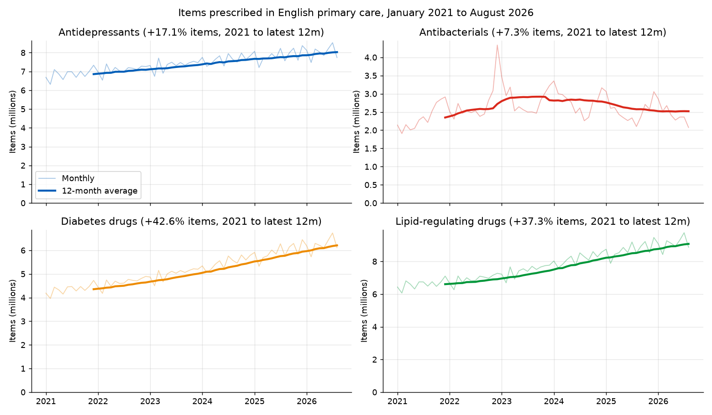
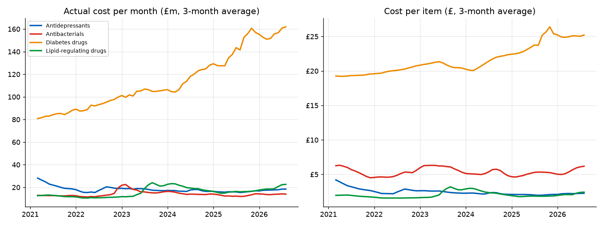
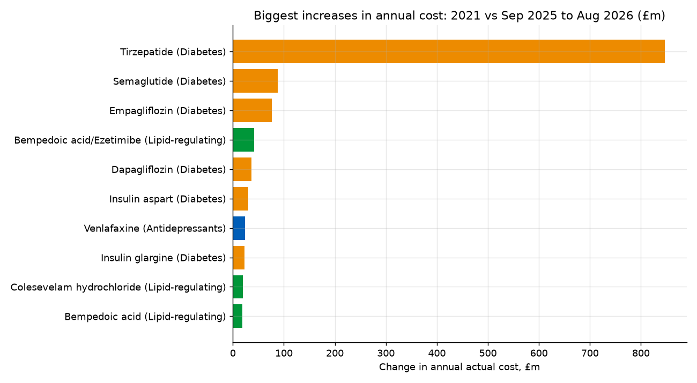
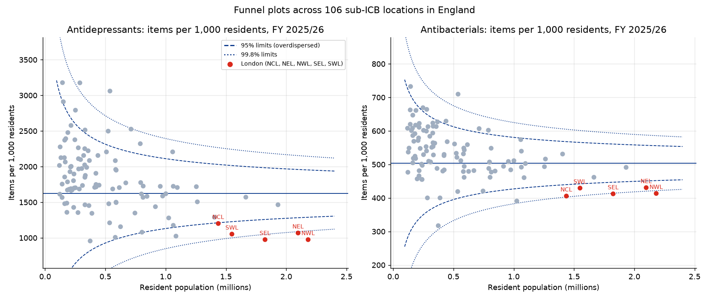
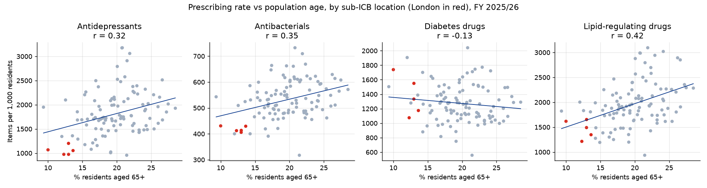
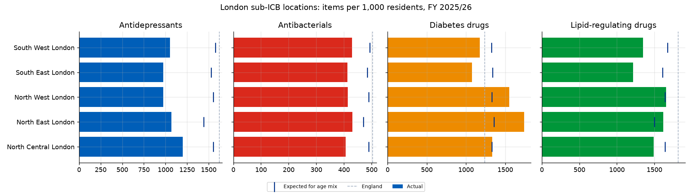
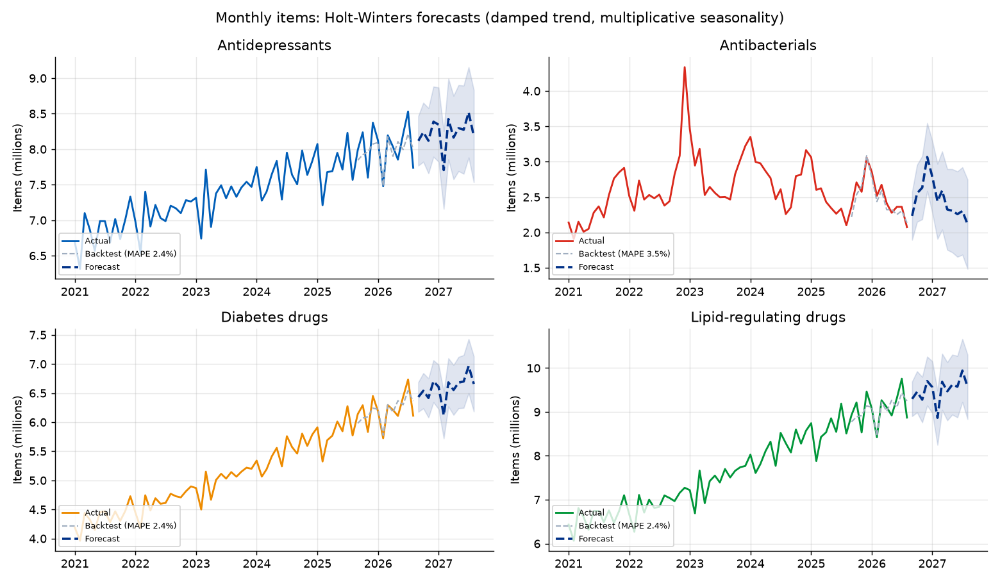

# English primary care prescribing trends: antidepressants, antibiotics, diabetes and lipid drugs (2021 to 2026)

An end-to-end analysis of NHS prescribing in English primary care from January 2021 to August 2026. It uses the NHSBSA
English Prescribing Dataset, which records every prescription item dispensed in the community (about 18 million rows a month).
The pipeline asks the NHSBSA open data API to aggregate 68 monthly files on the server. It then tracks items, cost and cost
per item in four clinically important areas, finds the drugs behind the changes, and compares 106 sub-ICB locations
(with a focus on London) using population rates, overdispersed funnel plots and z-scores. It finishes with seasonal
forecasts and a Streamlit dashboard.

Author: Anthony Adusei-Poku ([@anthony07-max](https://github.com/anthony07-max))



## Key findings
Comparisons are between calendar year 2021 and the latest 12 months (September 2025 to August 2026), for England.

| Area (BNF section) | Items 2021 | Items latest 12m | Change | Actual cost latest 12m | Cost change | Cost per item |
|---|---|---|---|---|---|---|
| Antidepressants (4.3) | 82.3m | **96.4m** | +17.1% | £210.0m | **-21.9%** | £3.27 → £2.18 |
| Antibacterials (5.1) | 28.2m | **30.2m** | +7.3% | £165.7m | +8.7% | £5.41 → £5.48 |
| Diabetes drugs (6.1.1, 6.1.2) | 52.2m | **74.5m** | +42.6% | £1,892.9m | **+87.0%** | £19.37 → £25.41 |
| Lipid-regulating drugs (2.12) | 79.3m | **108.9m** | +37.3% | £228.0m | +52.8% | £1.88 → £2.09 |

1. **Diabetes drug spending almost doubled, by £881m a year, and almost all of the increase came from one class.**
   Tirzepatide went from nothing in 2021 to **£847m** across 3.7m items in the latest 12 months. Tirzepatide and the
   GLP-1 agonists (mainly semaglutide, £54m → £142m) account for **98.2%** of the rise in diabetes drug costs.
   The SGLT2 inhibitors empagliflozin (+£76m) and dapagliflozin (+£36m) come next.
2. **Antidepressant items rose 17% while cost fell 22%.** Sertraline, the most prescribed antidepressant
   (26.1m items), rose by 29% in volume while its cost halved (£85.1m → £43.6m). Cost per item across all
   antidepressants fell from £3.27 to £2.18.
3. **Lipid-regulating items rose 37%**, with atorvastatin making up 79.5m of the 108.9m items. Newer non-statin drugs
   (bempedoic acid with ezetimibe: £0.08m → £42.0m) are a growing part of the cost.
4. **London prescribes far fewer antidepressants, partly because its population is younger.** In FY 2025/26 London had
   1,045 antidepressant items per 1,000 residents, against 1,727 in the rest of England (-39.4%). Antibiotics were 19.4% lower
   and lipid drugs 21.3% lower. Only 12.3% of Londoners are aged 65+, against 19.9% elsewhere. Allowing for age mix explains
   only part of the gap: every London sub-ICB is still **23% to 37% below** the antidepressant rate expected for its age mix.
5. **Diabetes is the exception in London.** London is 15.9% *above* the rest of England. North East London has
   1,739 items per 1,000 (+40.5% against England). It is the most extreme outlier in the whole funnel analysis (overdispersed
   z = +5.5) and is still 28% above the rate expected for its age mix.
6. **Variation and outliers.** Across 106 sub-ICB locations, the 95th-percentile area prescribes 2.4 times as many
   antidepressants per resident as the 5th-percentile area (1.6 times for antibiotics). After overdispersion correction,
   18 area-and-drug combinations fall outside 99.8% funnel limits. High outliers include County Durham (antidepressants
   3,060, antibiotics 710 and lipid drugs 3,094 per 1,000) and Sunderland (antidepressants 3,176). The highest raw rates for
   antidepressants (3,178), antibiotics and diabetes drugs are in the former Blackpool CCG area (00R). This is a smaller area,
   so it stays inside the funnel limits.
7. **Sanity check: an artefact we caught.** Vale of York (03Q) appears *lowest* in all four areas, and its neighbour North
   Yorkshire (42D) is high. This pattern points to a denominator mismatch (patients registered with practices in a different
   sub-ICB from where they live), not genuinely low prescribing, so it is reported but not interpreted.
8. **Forecasts.** Holt-Winters models with a 12-month backtest MAPE of 2.4% to 3.5% project 79.1m diabetes items (+6%)
   and 114.0m lipid items (+5%) over the next 12 months. They beat a seasonal-naive benchmark for three of the four areas. For
   antibiotics (3.5% against 3.3%) the simple benchmark is as good, because antibiotic demand follows winter infections rather
   than a trend.

| | |
|---|---|
|  |  |






## Method
- **Download** (`src/download.py`): for each month from January 2021 to August 2026, two SQL queries go to the NHSBSA CKAN
  `datastore_search_sql` endpoint. One returns items, actual cost and net ingredient cost by sub-ICB and therapeutic area.
  The other returns national totals by chemical substance. The script handles schema changes over time (STP to ICB in 2022,
  `BNF_CODE` to `BNF_PRESENTATION_CODE`, numeric columns stored as text). It also downloads ONS mid-2024 population by sub-ICB.
- **Areas** are defined by BNF section: 4.3 antidepressants, 5.1 antibacterials, 6.1.1 and 6.1.2 insulins and antidiabetic
  drugs, and 2.12 lipid-regulating drugs.
- **Clean** (`src/clean.py`): maps each prescribing organisation to a 2024 sub-ICB location (SICBL) by ODS code, and
  computes % aged 65+ from ONS single-year-of-age estimates.
- **Analyse** (`src/analysis.py`): SQL (SQLite) aggregations; items per 1,000 residents for FY 2025/26;
  **overdispersed funnel plots** (Spiegelhalter 2005: Poisson z-scores scaled by a winsorised overdispersion factor, with 95%
  and 99.8% limits); **age-adjusted z-scores** (residuals after regressing the rate on % aged 65+); and Holt-Winters
  forecasts (damped trend, multiplicative seasonality), backtested on the last 12 months against a seasonal-naive benchmark.
- FY 2025/26 is used for the area comparison because it is the latest full year on the 2024 sub-ICB geography that matches
  the ONS population file. Several ICBs merged in April 2026. In that year, 99.7% of items map to a sub-ICB.

## Data sources and licences
- NHS Business Services Authority, [English Prescribing Dataset (EPD) with SNOMED code](https://opendata.nhsbsa.net/dataset/english-prescribing-dataset-epd-with-snomed-code),
  via the [NHSBSA Open Data Portal](https://opendata.nhsbsa.net/) API. Contains NHSBSA data, © NHSBSA, licensed under the
  [Open Government Licence v3.0](https://www.nationalarchives.gov.uk/doc/open-government-licence/version/3/).
- Office for National Statistics, [population estimates for 2024 sub-ICB locations, mid-2022 to mid-2024](https://www.ons.gov.uk/peoplepopulationandcommunity/populationandmigration/populationestimates/datasets/clinicalcommissioninggroupmidyearpopulationestimates).
  Source: Office for National Statistics, licensed under the Open Government Licence v3.0.
- Methodology reference: Spiegelhalter D. (2005) *Handling over-dispersion of performance indicators*, BMJ Quality & Safety.

## Project structure
```
src/download.py      # server-side aggregated monthly extracts from the NHSBSA API + ONS population -> data/raw/
src/clean.py         # tidy national, sub-ICB and substance tables -> data/processed/
src/analysis.py      # SQL analysis, funnel plots, z-scores, forecasts, charts, key_findings.json
app/streamlit_app.py # interactive dashboard (trends, drug drivers, variation and outliers, forecasts)
charts/              # PNG outputs
data/processed/      # tidy CSVs used by the dashboard
```

## How to run
```bash
python -m venv .venv && source .venv/bin/activate
pip install -r requirements.txt
./run_pipeline.sh                      # about 136 API queries; reruns skip months already downloaded
streamlit run app/streamlit_app.py     # dashboard at http://localhost:8501
```

## Limitations
- **Items are not patients or doses.** One item can be 7 days or 3 months of treatment, so changes in prescription length
  affect item counts. Quantity or average daily quantities would be a better volume measure.
- **BNF classification is by drug, not by indication.** Tirzepatide and semaglutide in BNF 6.1.2 include prescribing for weight
  management (NHS tirzepatide prescribing for obesity began in primary care in 2025), so "diabetes drugs" overstates
  diabetes-only spending.
- Rates use **ONS resident population (mid-2024)**, not registered list sizes. That is why some areas, such as Vale of York,
  are distorted. Age adjustment is a simple regression on % aged 65+, not full standardisation, and does not account for
  deprivation, ethnicity or disease prevalence.
- About 0.3% of items come from organisations that are not sub-ICBs (out-of-hours providers, trusts) and are left out of
  area rates, but included in national totals.
- EPD covers prescriptions dispensed in the community in England. Hospital and private prescribing are excluded.
- Forecast bands are heuristic intervals based on residuals, not formal prediction intervals.
